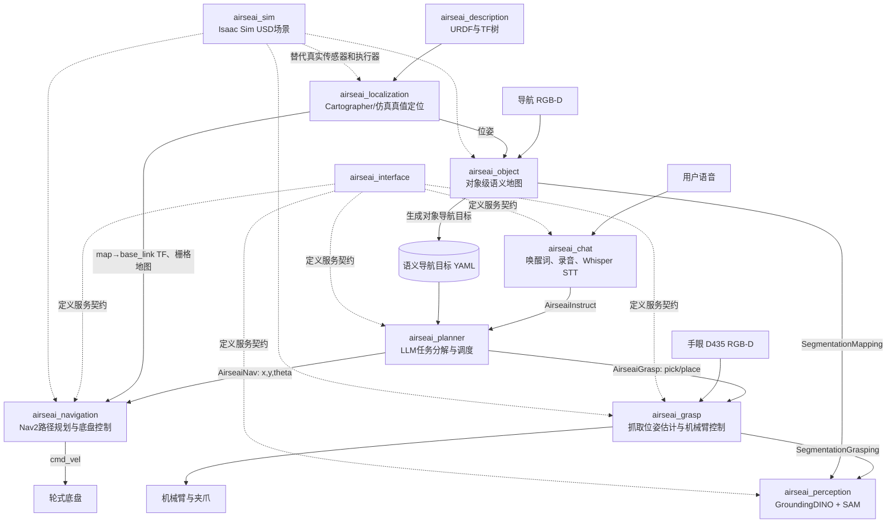

# AIRSEAI-1.0 项目主要模块、功能与原理分析

## 1. 分析结论摘要

AIRSEAI-1.0 是一个面向轮式移动操作机器人的具身智能软件栈。它以 ROS 2 Humble 为通信和部署骨架，把语音交互、大语言模型任务分解、开放词汇视觉分割、语义地图、定位建图、Nav2 导航以及 RGB-D 抓取串联起来，使机器人能够执行类似“把桌上的杯子拿到另一张桌子”这样的自然语言任务。

仓库实际上包含三条性质不同的技术线：

1. **AIRSEAI 机器人运行时主链路**：`airseai_chat`、`airseai_planner`、`airseai_perception`、`airseai_object`、`airseai_localization`、`airseai_navigation`、`airseai_grasp`、`airseai_interface`、`airseai_description` 和 `airseai_sim`。
2. **EmbodiData 数据后处理工具**：把第一视角 iPhone 采集数据加工为手部轨迹、质量指标和训练用结构化数据；它不是 ROS 2 在线控制链路的一部分。
3. **EmbodiCore 硬件语义研究制品**：研究有状态具身策略在硬件编译时的生命周期、复位和复用合法性，并提供可移植 RTL 与审计证据；它也没有接入当前机器人运行时。

主系统采用“**大模型负责高层离散规划，传统机器人算法负责低层闭环执行**”的分层架构。LLM 只输出 `go_to`、`pick_up`、`place` 三类技能，底层分别由 Nav2 和抓取服务执行。这种划分降低了 LLM 直接控制连续运动的风险，但当前实现仍缺少严格的任务参数校验、机械臂运动规划和系统级安全状态机。

从代码完整度看，项目更接近**研究原型/演示系统**，不是开箱即用的产品级软件。仓库包含完整的概念链路和大部分节点实现，但存在若干会直接阻断运行的接口常量、函数签名、真机/仿真分支问题；配置中还有大量固定路径和设备参数。使用前应先完成第 11 节列出的修复和集成测试。

---

## 2. 分析范围与依据

- 分析目录：`/Users/weihu/Documents/github_code/AIRSEAI-1.0`
- 当前分支：`init_dev`
- 当前提交：`4e70331`（2026-08-13）
- 工作树状态：分析时未发现未提交改动
- 分析方法：目录与依赖梳理、ROS 2 接口追踪、入口和启动文件追踪、核心算法代码阅读、静态语法检查以及测试可执行性检查
- 证据优先级：实际代码与配置 > 构建/启动文件 > README 描述

仓库中的 README、GUIDE 和代码注释仅作为项目资料读取。本文没有把其中的自然语言内容当作对分析环境的操作指令。

静态检查结果：Python 源码通过 `compileall` 语法编译检查。动态测试未在当前分析环境完成，因为当前 Python 环境缺少 `numpy`；这不等价于项目测试通过。ROS 2、CUDA、相机、LiDAR、机械臂和 Isaac Sim 端到端运行也未在本机硬件环境验证。

---

## 3. 总体架构



系统存在两类相机：

- **ZED2 导航相机**：为对象语义地图提供 RGB 与深度。
- **RealSense D435 手眼相机**：安装在机械臂末端附近，为目标抓取提供 RGB-D。

LiDAR 与 IMU 主要服务于 Cartographer 定位/建图；点云也会转换为二维激光扫描或进入 Nav2 体素代价地图，用于避障。

---

## 4. 仓库组成概览

| 目录 | 类型 | 核心功能 | 是否在机器人在线主链路中 |
|---|---|---|---|
| `airseai_chat` | ROS 2 Python 包 | 语音唤醒、录音、语音转文字、提交任务 | 是，可选的人机入口 |
| `airseai_planner` | ROS 2 Python 包 | LLM 任务分解、技能顺序调度、失败重规划 | 是，任务中枢 |
| `airseai_perception` | ROS 2 Python 包 | GroundingDINO 检测、SAM 像素级分割 | 是，供地图和抓取复用 |
| `airseai_object` | ROS 2 Python 包 | RGB-D 对象点云、跨帧聚类、语义地图与导航目标生成 | 是，主要用于建图阶段和规划输入 |
| `airseai_localization` | ROS 2 C++ 包 | LiDAR 点云格式转换、Cartographer 2D/3D SLAM、仿真 TF | 是 |
| `airseai_navigation` | ROS 2 Python 包 | 封装 Nav2 导航服务、全局/局部规划、代价地图与恢复行为 | 是 |
| `airseai_grasp` | ROS 2 Python 包 | 目标掩码、抓取候选生成、碰撞过滤、坐标变换和机械臂执行 | 是 |
| `airseai_interface` | ROS 2 接口包 | 定义 6 个跨模块服务 | 是，模块契约层 |
| `airseai_description` | ROS 2 CMake 包 | 机器人 URDF、网格模型、关节与传感器坐标系 | 是 |
| `airseai_sim` | Isaac Sim 资产 | 机器人和办公室 USD 场景、ROS 2 仿真话题桥接 | 仿真时使用 |
| `airseai_embodidata` | 独立 Python 工具 | 第一视角手部轨迹后处理、QA、数据导出 | 否，离线数据线 |
| `airseai_embodicore` | Python + SystemVerilog 研究制品 | 有状态模型硬件语义合法性、RTL和证据审计 | 否，研究/硬件线 |
| `scripts`、`docs` | Shell/文档 | 环境安装、启动案例和本地部署说明 | 支撑层 |

根 README 把抓取目录写成了 `airseai_grasping`，实际目录和 ROS 包名是 `airseai_grasp`。

---

## 5. 在线任务的完整工作流程

以“把 A 桌上的杯子放到 B 桌”为例，系统设计流程如下。

### 5.1 语音输入

1. `airseai_chat` 使用 PocketSphinx 持续检测 `airseai/air ship` 唤醒词。
2. 唤醒后播放提示音，并以幅值阈值检测说话开始和静音结束。
3. 将 16 kHz 单声道音频保存为 WAV。
4. 通过 OpenAI 兼容接口调用 Whisper，把音频转为文本。
5. 通过 `/airseai_planner/planner_server` 服务提交文本指令。

### 5.2 LLM 任务分解

1. `airseai_planner` 读取对象语义地图 YAML，将标签转换为 `{名称: [x,y,theta]}`。
2. 把语义地图、用户指令、可用技能和 JSON 输出格式一起写入 prompt。
3. GPT-4o 或代码中保留的 Llama/Ollama 后端返回 JSON，例如：

```json
[
  {
    "go_to": "table_a [1.2, 0.6, 1.57]",
    "pick_up": "cup",
    "place": "table_b [3.4, -0.2, 0.0]"
  }
]
```

4. 解析器把每组 JSON 展开成顺序技能：

```text
go_to(table_a) → pick_up(cup) → go_to(table_b) → place(cup)
```

5. 调度器同步调用导航和抓取服务；失败时设计上会根据“未找到对象”或“不可达位置”反馈修改任务并重试。

### 5.3 移动导航

1. 导航服务通过 TF 获取 `map → base_link` 当前位姿。
2. 使用 Nav2 `getPath` 查询全局路径。
3. 路径为空则返回不可达；否则计算路径总长度。
4. 以 `max(路径长度 / 最大速度 × 放大系数, 最短运行时间)` 估计超时阈值。
5. `goToPose` 交给 Nav2 行为树执行，全局规划、局部控制和恢复行为共同完成移动。

### 5.4 目标抓取

1. 抓取服务同步取得 D435 彩色图与对齐深度图。
2. 把目标名与彩色图送给 `airseai_perception`。
3. GroundingDINO 用文本类别定位目标框，NMS 去除重复框；SAM 根据候选框生成像素掩码。
4. 抓取分支选取检测置信度最高目标的掩码。
5. RGB、深度和掩码被转换为局部点云，并采样固定数量的点。
6. Scale-Balanced-Grasp/GraspNet 生成 6-DoF 抓取候选。
7. 模型无关碰撞检测器排除会与场景点云碰撞的候选，再执行 NMS 和分数排序。
8. 根据候选与目标掩码三维中心的距离及末端角度约束选择抓取姿态。
9. 通过手眼标定和齐次变换把相机系候选转换到机械臂基座坐标系。
10. 真机通过 `pymycobot` socket 控制 MyCobot 630；Isaac Sim 分支使用解析逆运动学并发布 `joint_command`。

### 5.5 放置

规划器先导航到目标桌位置，再调用 `place`。当前放置逻辑不是视觉引导的精确放置：真机分支把机械臂移动到固定初始姿态后张开夹爪，仿真分支直接张开夹爪。因此它更接近“到达指定区域后释放”，而不是完整的目标位姿放置规划。

---

## 6. 各核心模块的功能与实现原理

### 6.1 `airseai_interface`：跨模块契约

该包通过 ROSIDL 生成六种服务：

| 服务类型 | 请求 | 响应 | 用途 |
|---|---|---|---|
| `AirseaiInstruct` | `msg` 文本 | 总体返回码 | Chat → Planner |
| `AirseaiNav` | `x,y,theta` | 导航状态码 | Planner → Navigation |
| `AirseaiGrasp` | `task,obj` | 抓取状态及 `x,y,z` | Planner → Grasp |
| `SegmentationGrasping` | 对象名、图像 | 单个掩码 | Grasp → Perception |
| `SegmentationMapping` | 图像 | 多掩码、多标签 | Object Map → Perception |
| `SaveObjectNavGoal` | 输出 YAML 路径 | 成功标志、消息 | 外部工具 → Object Map |

这里采用服务而不是话题，符合“请求—响应式技能调用”的结构；但抓取和导航是长耗时动作，从 ROS 2 语义上更适合使用 Action，以获得进度、取消和超时控制。

### 6.2 `airseai_chat`：语音交互

主要实现文件：`airseai_chat/airseai_chat/chatbot_node.py`。

功能分层：

- PocketSphinx：本地低成本唤醒词检测。
- PyAudio：流式采集麦克风 PCM。
- 能量阈值 VAD：以采样块最大振幅判断说话/静音。
- Whisper API：将录音转成文本。
- ROS 2 Service Client：向任务规划器提交文本并解释返回码。

这种“本地唤醒 + 云端/兼容服务转写”能减少持续上传音频，但幅值阈值固定为 2000，易受麦克风增益和环境噪声影响，缺少自适应噪声基线与真正的语音活动检测模型。

### 6.3 `airseai_planner`：LLM 规划与技能调度

主要实现：`task_planner.py` 和 `llm_planner_node.py`。

其原理不是让 LLM 生成底层轨迹，而是让 LLM 做受限的符号规划：

```text
自然语言 + 可用地点 + 技能集合
              ↓ LLM
受限 JSON 任务描述
              ↓ 确定性解析
ROS 2 技能调用序列
```

代码包含两个 LLM 适配器：

- `GPT4_Task_Planner`：使用 OpenAI 兼容 SDK，模型名固定为 `gpt-4o`。
- `LLAMA_Task_Planner`：向 Ollama 风格 `/api/chat` 地址发送 HTTP 请求，模型名固定为 `llama3.1:70b-instruct-fp16`；节点当前默认启用 GPT 分支，Llama 分支被注释。

规划器把语义地图坐标放进 prompt，要求模型只使用地图中的桌面名称。但程序没有对 LLM 返回的标签或坐标再次与语义地图比对，所以“约束”目前主要依赖提示词，而不是代码层强制验证。

失败重规划的设计思想是闭环的：抓取未发现目标时，把失败桌面加入历史反馈，让 LLM 改去其他位置；目标不可达时，根据抓取服务返回的位置重新导航。不过当前错误码实现有严重不一致，详见第 11 节。

### 6.4 `airseai_perception`：开放词汇目标分割

主要实现：`seg_service_node.py`、`lib/grounded_sam_api.py`。

核心算法组合：

1. **GroundingDINO** 接收图像和文本类别，输出边界框、置信度与类别。
2. **NMS** 根据 IoU 抑制重复检测框。
3. **SAM** 以每个检测框为 prompt，生成多个候选 mask，保留 SAM 分数最高的 mask。

提供两种服务模式：

- 抓取模式：只查询调用方指定的一个对象，阈值较高，并只返回最高置信目标的 mask。
- 建图模式：一次查询 `semantic_label_table.txt` 中的全部类别，返回所有 mask 与标签。

这使系统具备一定零样本/开放词汇能力：无需为每个家庭或仓库物体重新训练传统检测器，只要视觉语言模型认识文本概念即可。但 GroundingDINO 和 SAM 的串联计算量大，且每个检测框逐个调用 SAM，实时性依赖 Jetson GPU、类别数量和图像分辨率。

### 6.5 `airseai_object`：对象级语义地图

主要实现：`object_map_node.py`、`object_depth.py`、`segmentation_service_client.py`，以及预编译的 `lib/map.cpython-310-aarch64-linux-gnu.so`。

工作原理：

1. 使用 `ApproximateTimeSynchronizer` 对齐 ZED RGB、深度和机器人位姿，允许约 0.1 秒时间差。
2. 调用多类别分割服务。
3. 腐蚀 mask 边缘，降低深度突变和分割边界噪声。
4. 使用相机针孔模型将 mask 内像素反投影成三维点：

   ```text
   X = (u - cx) · Z / fx
   Y = (v - cy) · Z / fy
   Z = depth(u,v)
   ```

5. 使用相机到 `base_link` 的外参，再结合每帧机器人全局位姿，将对象点云转换到地图坐标系。
6. 将有效观测保存为 keyframe；后台线程合并点云、聚类跨帧观测，形成对象实例。
7. 对每个对象投影到二维，并从历史观测位姿中选择距离对象最近的位置，朝向设为面向对象，从而生成导航目标 `(x,y,theta)`。
8. 把对象标签与导航目标保存成 YAML，供 LLM Planner 加载。

该模块承担关键的“语义—几何桥梁”：LLM 理解的是“杯子/桌子”，Nav2 接受的是地图坐标，它把两者连接起来。

局限：核心 `Map` 类只有针对 AArch64 CPython 3.10 的预编译 `.so`，仓库没有对应 Python/C++ 源码。因此点云合并、对象聚类、实例关联、下采样和包围盒算法无法仅凭此仓库完整审计，也降低了 x86 与其他 Python 版本的可移植性。

### 6.6 `airseai_localization`：建图、定位与坐标变换

该包包含三类能力：

- `rslidar_conversion_node.cpp`：把 RoboSense 点类型转换成 Cartographer 需要的 `PointXYZIT`，并根据点时间戳重建扫描内相对时间。
- `isaac_conversion_node.cpp`：为 Isaac Sim 点云补充 Cartographer 所需字段。
- 多组 launch + Lua：启动 Cartographer 2D/3D 建图、加载 `.pbstream` 定位、生成占据栅格并启动 RViz。

真机设计上融合 Helios 32 LiDAR 和 CH104 IMU，由 Cartographer 输出机器人在预建地图中的位置。仿真可选择 Cartographer 路径，或者使用 `/odom` 经 `isaac_odom_to_tf_node` 形成近似真值 TF。

`airseai_description` 发布的 URDF TF 树定义了底盘、LiDAR、ZED2、六轴机械臂、夹爪和 D435 的静态/动态坐标关系，是定位、点云转换和抓取坐标变换的共同几何基础。

### 6.7 `airseai_navigation`：Nav2 封装

启动文件组合了以下 Nav2 组件：

- Map Server：加载二维占据栅格。
- Planner Server：使用 `NavfnPlanner` 生成全局路径。
- Controller Server：使用外部依赖 `neo_local_planner2::NeoLocalPlanner` 跟踪路径。
- Local/Global Costmap：静态层、体素障碍层和膨胀层。
- Behavior Server：旋转、后退、等待等恢复行为。
- BT Navigator：使用仓库内 XML 行为树组织重规划和恢复。
- Waypoint Follower：支持多航点任务。
- `pointcloud_to_laserscan`：把 LiDAR 点云转换为二维扫描输入。

`navigation_service_node.py` 再把 Nav2 封装成简单的 `(x,y,theta) → status` 同步服务，方便 LLM Planner 调度。这一封装降低了上层复杂度，但也隐藏了 Nav2 Action 原生的反馈和取消能力。

### 6.8 `airseai_grasp`：六自由度抓取与执行

抓取算法链可分为四层：

1. **目标选择**：用文本目标的 SAM mask 把“抓哪个对象”转换为像素区域。
2. **几何构造**：利用 D435 内参和深度生成局部点云，在扩展后的目标邻域采样 20,000 点。
3. **候选生成与筛选**：Scale-Balanced-Grasp 的 `GraspNet_MSCQ` 预测抓取位姿；Model-Free Collision Detector 进行碰撞过滤；随后 NMS、分数排序并保留前若干候选。
4. **机器人执行**：通过一系列齐次变换把候选从虚拟夹爪/相机坐标系变换到机械臂基坐标系，再根据角度、距离和可达性选择目标。

真机执行依赖 Elephant Robotics `pymycobot`；仿真分支包含一套针对当前六轴几何的解析逆运动学。解析 IK 只根据目标位置计算固定腕部姿态，没有通用碰撞检测或轨迹优化，因此不等价于 MoveIt 级别的运动规划。

### 6.9 `airseai_description`：机器人数字几何模型

URDF 描述：

- `base_footprint → base_link` 底盘坐标系；
- 多个轮组及连续关节；
- IMU、Helios LiDAR 和 ZED2 的安装坐标系；
- 六个旋转关节的机械臂；
- 末端执行器、联动夹爪结构；
- RealSense D435 彩色、深度和红外坐标系；
- STL 网格、惯量、关节上下限和视觉/碰撞几何。

它既用于 RViz/robot_state_publisher，也为 Isaac Sim 资产和抓取 TF 提供结构参考。

### 6.10 `airseai_sim`：Isaac Sim 仿真环境

该目录不是标准 ROS 包，而是两个较大的 USD 资产：机器人本体场景和办公室场景。通过 Isaac Sim ROS 2 Bridge，它模拟发布：

- `/Imu_data`
- `/odom`
- `/rslidar_points`
- ZED 左右图与深度
- D435 彩色与对齐深度
- `/joint_states`

并订阅：

- `/cmd_vel`
- `/joint_command`

因此仿真环境在接口层尽量替代真实传感器和执行器，使定位、导航、感知、语义地图和抓取模块可复用同一套 ROS 2 接口。

---

## 7. 两个独立研究子系统

### 7.1 `airseai_embodidata`：第一视角手轨迹数据加工

这是一个独立 Python CLI 工具，目标是把头戴 iPhone 的人类操作演示转换为结构化手部轨迹。当前代码实现的理论分解是：

```text
T_world_hand(t) = T_world_camera(t) · T_camera_hand(t)
```

- `T_world_camera`：来自 ARKit 的相机 6-DoF 位姿，并按时间插值。
- `T_camera_hand`：MediaPipe 手部二维/局部三维关键点经个体手长尺度化，再用 PnP 估计。

流水线模块：

1. `ingest.py`：读取视频、`imu.csv`、`pose.csv`、可选 `frames.csv` 和相机内参。
2. `sync.py`：用陀螺仪和相机旋转速度互相关检查/估计时钟偏移，并检测开头与结尾静止段。
3. `detect2d.py`：MediaPipe Hands 检测左右手及 21 个关键点，并缓存结果。
4. `lift3d.py`：以个体手长恢复近似公制尺度，SQPnP/迭代 PnP 求相机系手姿态；可选深度进一步约束。
5. `egomotion.py`：统一 ARKit、OpenCV 和可选机器人 Z-up 坐标约定，连续插值相机位姿。
6. `tracking.py`：左右手关联、恒速 Kalman、马氏距离门限、One Euro 滤波、RTS 离线平滑和短缺失填补。
7. `export.py` / `qa.py`：输出 CSV、NPZ、JSON、叠加视频、轨迹图和 PASS/WARN/FAIL 质量报告。

它的科学价值在于同时输出数值、有效性 mask 和数据来源标志，区分“直接检测”“短缺失填补”和“缺失”，避免下游训练把插值数据误当成真实观测。

但当前目录存在明显版本错位：

- 顶层 `airseai_embodidata/README.md` 描述的是 `raw/session_video.mov`、JSONL、无真实相机位姿时的 camera-relative baseline，输出名为 `hands_camera.*`。
- 当前 `ingest.py` 和 `pipeline.py` 实际要求 episode 根目录中的视频、`imu.csv` 和必需的 `pose.csv`，执行世界坐标合成，输出 `hands.csv`、`hands.npz`、`hand_annotation.json` 等。
- `GUIDE.md` 更接近当前代码，但与 README 对数据可用性和科学边界的说法冲突。

因此在数据采集或论文引用前，必须先确定哪一版格式是权威规范，并使 README、CLI、测试和代码统一。

### 7.2 `airseai_embodicore`：有状态策略的语义感知硬件编译

EmbodiCore 的核心观点是：对 Mamba 等有状态模型做硬件优化时，不能只看张量依赖、存储生命周期和资源约束，还必须先遵守真实机器人执行循环中的语义生命周期。

代码定义四级生命周期顺序：

```text
scan < denoise < policy < episode
```

一个候选设计只有在状态和条件的复用范围不超过执行契约允许范围时才合法。例如：

- selective scan 状态应在每次独立 scan 开始时复位；跨 episode 持久化会把上一调用的状态污染到下一调用。
- observation condition 可在同一 policy 的多次 denoise 中复用，但新观测到来时必须更新；跨 episode 复用会形成陈旧条件。

`compiler/reference_semantic_filter.py` 在硬件代价排序前过滤非法候选；SystemVerilog `embodicore_semantic_controller` 根据 `episode_reset`、`policy_start`、`observation_update`、`denoise_start` 和 `scan_start` 生成 `condition_load` 与 `scan_reset`；`condition_ingress` 模拟条件张量经外部总线加载并统计传输拍数。

该目录主要是论文 claim-audit artifact，而不是完整的 Mamba 加速器：

- 提供可重跑的语义负例、RTL、自检和证据校验。
- 历史 4096 候选 DSE 的原始生成器、成本模型和完整原始结果未包含；相应结果只是冻结的 claim record。
- PG2K400 结果只证明语义控制器/条件入口的物理可实现性，不能解释为完整策略加速或 10 倍端到端性能。

仓库 CI 目前只显式验证这一 EmbodiCore 制品，未覆盖 ROS 机器人主链路。

---

## 8. 核心技术原理

### 8.1 分层具身控制

系统把任务分为三层：

| 层级 | 表示 | 负责模块 |
|---|---|---|
| 意图层 | 自然语言目标 | Chat、LLM Planner |
| 技能层 | `go_to/pick_up/place` | Planner 调度与 ROS 服务 |
| 连续控制层 | 路径、速度、关节、夹爪命令 | Nav2、底盘控制器、抓取模块 |

优点是每层可以替换：语音入口可换成文本 UI，LLM 可换成本地模型，局部规划器、分割模型或机械臂也可独立替换。代价是跨层接口和状态码必须非常稳定，而当前代码恰好在这一点上存在缺陷。

### 8.2 语义地图作为符号与几何的中间层

传统导航地图只表达“哪里可通行”，不表达“杯子或桌子在哪里”。AIRSEAI 通过对象分割 + 深度反投影 + 机器人位姿，把语义对象绑定到全局几何位置，再生成可供导航的观察点。这样 LLM 无需理解点云，Nav2 也无需理解自然语言。

### 8.3 基于基础模型的目标指定

GroundingDINO 将语言映射到检测框，SAM 将框细化到像素掩码。其优势是开放词汇泛化，劣势是推理成本、误检以及文本类别歧义。建图模式使用固定类别表，可控制推理范围；抓取模式使用任务目标名，支持更灵活的对象指定。

### 8.4 RGB-D 六自由度抓取

抓取网络不是直接预测关节角，而是在相机点云上预测一组夹爪位姿。随后通过碰撞几何、目标 mask、候选分数、手眼标定和 IK逐层收缩候选空间。这种结构把学习方法擅长的几何候选生成与传统机器人几何约束结合起来。

### 8.5 SLAM 与 Nav2

Cartographer 根据 LiDAR/IMU 建立并追踪 `map` 坐标系；Nav2 在静态地图与在线障碍代价地图上进行全局规划和局部控制。行为树负责把“规划—跟踪—失败恢复—重新规划”组织成可执行流程。

---

## 9. 关键 ROS 2 数据流

| 名称 | 类型/方向 | 生产者 | 消费者 |
|---|---|---|---|
| `/airseai_planner/planner_server` | `AirseaiInstruct` 服务 | Planner | Chat/外部调用者 |
| `/airseai_navigation/navigate_to_pose` | `AirseaiNav` 服务 | Navigation | Planner |
| `/airseai_grasp/grasp_server` | `AirseaiGrasp` 服务 | Grasp | Planner |
| `/airseai_perception/SegmentationGrasping` | 分割服务 | Perception | Grasp |
| `/airseai_perception/SegmentationMapping` | 分割服务 | Perception | Object Map |
| `/airseai_object/save_object_nav_goal` | 保存服务 | Object Map | 外部调用者 |
| `/rslidar_points` | 点云话题 | LiDAR/Isaac Sim | Localization、Navigation 转换 |
| `/rslidar_points_converted` | PointXYZIT 点云 | Localization converter | Cartographer |
| `/Imu_data` | IMU 话题 | IMU/Isaac Sim | Cartographer |
| `/odom` | 里程计话题 | 底盘/Isaac Sim | 仿真 TF、Object Map 仿真配置 |
| `/cmd_vel` | 速度命令 | Nav2 controller | 底盘/Isaac Sim |
| `/camera/camera/color/image_raw` | D435 彩色图 | D435/Isaac Sim | Grasp |
| `/camera/camera/aligned_depth_to_color/image_raw` | D435 深度 | D435/Isaac Sim | Grasp |
| `/zed/zed_node/left/image_rect_color` | ZED 彩色图 | ZED/Isaac Sim | Object Map |
| `/zed/zed_node/depth/depth_registered` | ZED 深度 | ZED/Isaac Sim | Object Map |
| `joint_states` | 关节状态 | 仿真机械臂 | Grasp 仿真分支 |
| `joint_command` | 关节命令 | Grasp 仿真分支 | Isaac Sim |

注意：感知服务创建时使用相对名 `airseai_perception/...`，客户端使用绝对名 `/airseai_perception/...`。在无 namespace 的默认部署中通常可对应；一旦引入 namespace，应统一命名策略。

---

## 10. 外部依赖与部署假设

### 10.1 硬件假设

- Nvidia Jetson AGX Orin
- RoboSense Helios 32 LiDAR
- CH104 9 轴 IMU
- ZED2 导航 RGB-D 相机
- RealSense D435 手眼 RGB-D 相机
- AirsBot2 轮式底盘
- Elephant Robotics MyCobot 630 + 自适应夹爪
- LLM 可运行在独立 GPU 服务器，也可调用公开 API

### 10.2 软件假设

- Ubuntu 22.04、ROS 2 Humble、Python 3.10
- JetPack 6.0、CUDA/PyTorch
- Cartographer、Nav2、pointcloud_to_laserscan
- Open3D、OpenCV、SciPy、PyYAML、ROS `cv_bridge`
- GroundingDINO、Segment Anything、BERT 权重
- Scale-Balanced-Grasp、GraspNet API、PointNet2/KNN CUDA扩展
- `pymycobot`
- Isaac Sim 4.2（仿真）

`dependencies.yaml` 只固定了三个源码依赖的 commit：`neo_local_planner2`、`Grounded-Segment-Anything`、`Scale-Balanced-Grasp`。模型权重、GraspNet API、pymycobot 和多数 pip/apt 依赖未形成统一锁文件，因此环境复现仍依赖安装文档和外部资源。

---

## 11. 当前代码的主要问题与风险

以下问题来自当前提交的代码静态检查。它们不只是风格问题，其中若干会直接导致运行时异常。

### 11.1 P0：会阻断核心流程的问题

#### A. Planner 使用了接口中不存在的状态常量

`AirseaiInstruct.srv` 定义的是：

```text
EMPYT_INSTRUCTION, NAV_FAILED, PICK_FAILED, PLACE_FAILED, UNKNOWN_TASK
```

但 `llm_planner_node.py` 使用：

```text
EMPTY_INST, NAV_FAIL, PICK_FAIL, PLACE_FAIL, UNKOWN_TASK
```

这些名称无法由 ROSIDL 生成，进入相应分支时会产生 `AttributeError`。此外，重规划循环把 `AirseaiInstruct.ret` 与 `AirseaiGrasp` 的返回码常量混用，虽然 `SUCCESS` 都碰巧是 0，但错误空间并不一致，闭环重规划逻辑无法可靠工作。

建议：统一 `.srv` 常量名称；为每类服务使用自己的 enum/常量；用明确的状态转换表和单元测试覆盖所有失败路径。

#### B. GraspNet 调用缺少必需参数

`UtilityGraspNet.get_and_process_data(rgb, depth, mask, use_isaac_sim)` 需要四个参数，但 `grasp_pose_estimation()` 只传入三个参数。因此目标一旦被成功分割，代码会在抓取位姿估计阶段抛出 `TypeError`。

建议：把 `use_isaac_sim` 明确存入 `UtilityGraspNet`，或沿调用链完整传递，并分别测试真机/仿真深度单位。

#### C. 真机抓取初始化访问不存在的 `self.ik`

`self.ik` 只在 `use_isaac_sim=True` 时创建，但 `_handle_pick_task()` 无条件调用 `set_arm_init_states()`，该方法又无条件访问 `self.ik`。真机模式会在开始抓取时失败。

建议：真机模式使用 `UtilityElephantRobot.prepare_for_grasp()`；仿真模式再调用 IK 初始化，避免两套执行器混用。

#### D. Chat 节点的服务就绪标志可能未初始化

Planner 服务首次等待成功时，构造函数没有把 `self.llm_server_ready` 设为 `True`；主函数和识别线程都会读取该成员，可能触发 `AttributeError`。此外，成功识别并提交一次指令后循环直接 `break`，节点仍在 spin，但不再监听第二条语音。

建议：构造时先设默认值；把一次交互封装成可重复状态机；处理转写失败时未赋值的 `transcript`。

### 11.2 P1：明显影响正确性或可靠性的问题

#### A. 掩码中心反投影疑似交换行列

`get_3d_center_mask()` 中 `center_row` 与 `cx` 配对、`center_col` 与 `cy` 配对。按照图像坐标约定应为 `u=column`、`v=row`，即：

```text
X = (center_col - cx) * Z / fx
Y = (center_row - cy) * Z / fy
```

当前写法会改变目标三维中心，继而影响最佳抓取选择。

#### B. Isaac 点云相对时间使用整数除法

`isaac_conversion_node.cpp` 中 `(point_id / plsize) * 0.1` 的两个操作数是整数类型，大多数点会得到 0，而不是扫描内连续时间。应先转换为浮点。

#### C. 空点云存在越界风险

`rslidar_conversion_node.cpp` 过滤点之后直接访问 `pl_out.points.back()`；若所有点都无效会越界崩溃。抓取点云为空时也可能对空数组执行随机采样。

#### D. Object Map 超时日志引用不存在的成员

`segmentation_service_client.py` 超时分支使用 `self.service_name`，实际成员名是 `self.name_segmentation_service_server`，超时时会二次异常。

#### E. Object Map 后台线程可能空转占满 CPU

聚类线程在没有新 keyframe 时、可视化线程在地图为空时直接 `continue`，没有 sleep 或条件变量，可能形成忙循环。

#### F. `np.bool` 与现代 NumPy 不兼容

抓取代码使用已移除的 `np.bool` 别名。项目文档环境中的现代 NumPy 版本可能直接报错，应改为 `bool` 或 `np.bool_`。

#### G. 导航“最近点成功”判定与实际目标不一致

代码用浮点精确相等判断路径末点是否等于请求目标，容易误判；即使判定目标被规划器调整，随后 `goToPose()` 仍提交原始 `goal_pose`，不是路径末点。Planner 又只把状态 0 当成功，状态 1 的“到达最近点”会被当失败。

### 11.3 P2：工程化、可维护性与安全问题

- 多个 YAML 和 launch 文件固定写入 `/home/airsbot2/...`、设备索引、机械臂 IP 与模型路径，难以迁移。
- `package.xml` 中声明的运行依赖明显不完整；例如 perception/object/grasp 几乎没有列出实际依赖，navigation 的 buildtool 元数据也不一致。
- 没有顶层一键启动文件来保证模块启动顺序、生命周期管理和失败清理；文档依赖多个终端手工启动。
- LLM JSON 只检查能否解析，不验证 schema、动作白名单的完整性、对象名是否存在、坐标是否与语义地图一致或是否在安全工作区。
- GPT/Ollama 重试循环没有最大次数、退避或完整超时策略，服务故障可能无限阻塞。
- 导航和抓取采用同步 Service 承载长任务，取消、进度反馈和抢占能力弱。
- 机械臂真机执行主要是距离阈值 + 直接 `send_coords`，缺少 MoveIt 轨迹规划、自碰撞/环境碰撞检查、速度安全限制和急停集成。
- “place” 是固定姿态释放，不使用目标表面检测、放置候选或稳定性检查。
- 对象地图核心为单一 AArch64 `.so`，源码缺失且平台绑定。
- ROS 主链路没有单元测试、接口测试、仿真 smoke test 或 CI；现有 GitHub Actions 只验证 EmbodiCore。
- Python 包版本均为 `0.0.0`，维护者字段、拼写和错误码命名存在不一致，说明发布工程尚未收敛。
- 配置中为 API key 预留普通明文字段，真实部署应改为环境变量或密钥管理，避免提交凭据。

### 11.4 EmbodiData 专项问题

- README 与实现的数据格式、坐标系能力和输出文件命名冲突，需先完成规格统一。
- `tests/test_end_to_end.py` 导入 `handtraj.eval_gt`，但当前仓库不存在该文件；即使装齐依赖，该测试也会在导入阶段失败。
- 当前分析环境缺少 `numpy`，所以未能实际运行 `test_synthetic.py`；报告只能确认语法通过，不能声明数值测试通过。
- 单目手部公制深度依赖手长、内参和 PnP，文档中的毫米级合成测试不等价于真实场景精度；真实数据必须用标定物、动作捕捉或深度传感器验证。

---

## 12. 设计优点

尽管当前实现仍有问题，整体设计有几个清晰优点：

1. **模块职责明确**：语言、感知、地图、导航、抓取通过 ROS 2 接口解耦。
2. **高层智能与低层控制分离**：LLM 不直接生成速度或关节指令。
3. **语义地图连接语言和导航**：解决自然语言对象名到二维导航坐标的落地问题。
4. **感知能力复用**：同一 GroundingDINO + SAM 服务同时支持地图和抓取。
5. **真机/仿真接口接近**：Isaac Sim 使用相同传感器、速度和关节话题，便于先仿真后部署。
6. **学习与几何结合**：抓取网络负责候选，传统碰撞检查、标定和 IK 负责约束。
7. **扩展方向丰富**：EmbodiData 面向示教数据，EmbodiCore 面向具身策略硬件化，体现从数据到执行再到计算硬件的研究布局。

---

## 13. 建议的修复与演进顺序

### 第一阶段：恢复可运行基线

1. 统一所有 `.srv` 常量和 Planner 状态机。
2. 修复 GraspNet 参数、真机初始化、`np.bool` 和掩码中心坐标问题。
3. 修复 Chat 就绪状态与多轮监听。
4. 修复 LiDAR 空点云、Isaac 时间计算和 Object Map 忙循环。
5. 把固定绝对路径改成 package share 路径、launch 参数或环境变量。
6. 增加一个顶层 launch，显式区分 `real` 与 `sim` profile。

### 第二阶段：建立自动验证

1. 为六个服务定义接口契约测试，覆盖每个返回码。
2. 给 Planner 加 JSON Schema 和语义地图坐标校验测试。
3. 给相机反投影、手眼变换、抓取坐标链和解析 IK 添加数值测试。
4. 在 Isaac Sim 中建立最小 smoke test：启动 → 导航到桌面 → 识别对象 → 抓取 → 放置。
5. CI 至少执行 Python 单测、lint、ROS 2 build、接口测试；硬件测试可独立运行。

### 第三阶段：提高安全性和产品化程度

1. 将导航/抓取改为 ROS 2 Action，支持取消、反馈、抢占和超时。
2. 接入 MoveIt 2 或同等规划器，建立完整机械臂碰撞模型。
3. 建立任务执行器状态机，明确 idle/running/cancelled/failed/recovering 状态。
4. 对 LLM 输出实行结构化 schema、地图白名单、坐标边界和任务预算限制。
5. 增加运行健康监测、传感器超时、急停和安全速度区域。
6. 公开或替换 `airseai_object/lib/map...so` 的源实现，提升可审计性和可移植性。
7. 统一 EmbodiData 规范，并把数据质量门槛与训练入口连接起来。

---

## 14. 适合贡献者切入的任务

如果希望向该项目贡献代码，以下任务边界清晰、价值较高：

- 修复 Planner `.srv` 状态常量并补齐失败路径测试。
- 修复 GraspNet 参数传递和真机/仿真分支，构造无硬件 mock 测试。
- 修复 Chat 多轮监听和异常处理。
- 清理硬编码路径，统一通过 `ament_index_python` 和 launch 参数定位资源。
- 补全各 `package.xml` 的 ROS 和 Python 依赖。
- 增加顶层 `airseai_bringup` 包及 real/sim launch。
- 为 Object Map 忙循环引入事件/条件变量，并处理分割超时。
- 修复点云时间字段和空点云边界条件。
- 统一 EmbodiData README、输入 schema、输出 schema 与测试。
- 建立 ROS 2/Isaac Sim CI 或可重复的最小 Docker 测试。

其中，“接口常量统一 + 单元测试”最适合作为第一个 Pull Request：改动范围小、问题证据明确、对主链路价值高，也不依赖真实机器人硬件。

---

## 15. 主要代码证据索引

| 主题 | 代码/配置位置 |
|---|---|
| 总体目标与主架构 | `README.md` |
| LLM prompt、JSON 解析、GPT/Llama 后端 | `airseai_planner/airseai_planner/task_planner.py` |
| 技能调度与失败重规划 | `airseai_planner/airseai_planner/llm_planner_node.py` |
| 自定义服务协议 | `airseai_interface/srv/*.srv` |
| 语音唤醒、录音和 Whisper | `airseai_chat/airseai_chat/chatbot_node.py` |
| GroundingDINO + SAM | `airseai_perception/airseai_perception/seg_service_node.py`、`airseai_perception/lib/grounded_sam_api.py` |
| 对象语义地图节点 | `airseai_object/airseai_object/object_map_node.py` |
| 深度反投影 | `airseai_object/lib/object_depth.py` |
| 导航目标生成 | `airseai_object/lib/map_2d.py`、`io_nav_goal.py` |
| Nav2 服务封装 | `airseai_navigation/airseai_navigation/navigation_service_node.py` |
| Nav2 组件和参数 | `airseai_navigation/launch/*.py`、`config/neo_airsbot2*.yaml` |
| Cartographer 与点云转换 | `airseai_localization/src/*.cpp`、`launch/*.py`、`configuration_files/*.lua` |
| 抓取主流程 | `airseai_grasp/airseai_grasp/grasp_server_node.py` |
| 抓取网络和碰撞过滤 | `airseai_grasp/lib/utility_graspnet.py` |
| 真机控制与仿真 IK | `utility_elephant_robot.py`、`utility_ik.py` |
| 机器人几何和 TF | `airseai_description/urdf/airsbot2.urdf` |
| Isaac Sim 接口 | `airseai_sim/README.md`、`airseai_sim/airseai/*.usd` |
| EmbodiData 流水线 | `airseai_embodidata/handtraj/*.py`、`scripts/run_pipeline.py` |
| EmbodiCore 语义和 RTL | `airseai_embodicore/compiler/reference_semantic_filter.py`、`rtl/*.sv` |

---

## 16. 最终判断

AIRSEAI-1.0 的核心价值不是发明一套全新的 SLAM、导航或抓取算法，而是建立一个模块化的具身智能集成框架：用语言模型完成任务层推理，用视觉基础模型完成开放词汇感知，用对象语义地图完成语言到空间的绑定，再让成熟的机器人定位、导航和几何控制算法执行动作。

其架构思想清楚，研究方向覆盖“交互—规划—感知—空间—运动—数据—硬件”，但当前仓库不同子系统的成熟度和版本一致性差异较大。主机器人链路存在确定的运行时缺陷，EmbodiData 文档与代码错位，Object Map 的关键实现不透明；因此现阶段应把它视为可继续开发的研究平台，而不是已经完成工程验证的统一发行版。
