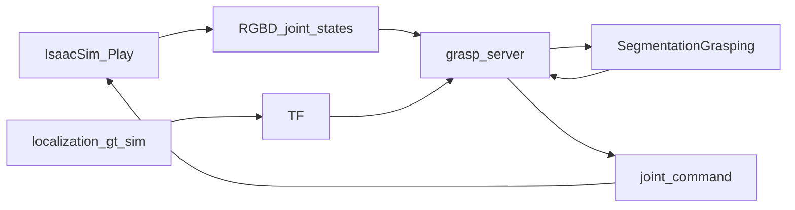

# Isaac Sim 最小抓取运行

这份说明只跑仓库里现有的 GraspNet 仿真抓取，用来看清一次 `pick` 怎么从相机走到机械臂。不启动语音、LLM Planner、Nav2、语义建图，也不涉及 Diffusion Policy。

验收停在：抓取服务有返回，仿真里夹爪或机械臂有动作，日志能对上「分割 → GraspNet → 解析 IK → `joint_command`」。不要求导航、放置或语言任务成功。

## 1. 数据怎么走



Isaac Sim 在 Play 之后发布腕部 RGB、对齐深度和 `joint_states`，并订阅 `joint_command`。定位节点发布机器人 TF。抓取节点把彩色图送给感知服务拿掩码，再用深度和 GraspNet 估计夹爪位姿，最后用解析 IK 算出关节角发给仿真。

## 2. 在哪台机器上跑

同一台 **Ubuntu 22.04** 上需要已经装好：

- Isaac Sim 4.2
- ROS 2 Humble
- 已 `colcon build` 的包：`airseai_interface`、`airseai_description`、`airseai_localization`、`airseai_perception`、`airseai_grasp`

当前这台开发机是 Ubuntu 20.04，不能当 Humble 节点的宿主机。A800 服务器没有显示器，也没有 NVENC，不适合看 Isaac 窗口。要看画面，在带 RTX 4090 的 Ubuntu 22.04 上打开场景并点 Play。

每个新终端都先执行：

```bash
source /opt/ros/humble/setup.bash
source ~/airseai/install/local_setup.bash
export ROS_DOMAIN_ID=1
```

`~/airseai` 换成你的 colcon 工作空间。感知和抓取终端还要各自 `conda activate`。

配置里大量路径写成 `/home/airsbot2/...`。至少把下面几处改成你机器上的真实路径，否则对应节点起不来：

- [`airseai_perception/config/config.yaml`](airseai_perception/config/config.yaml)：GroundingDINO、BERT、SAM 权重
- [`airseai_grasp/config/airseai_grasp_sim_config.yaml`](airseai_grasp/config/airseai_grasp_sim_config.yaml)：GraspNet `checkpoint.tar`

这次不启动导航，所以不用改 `map_sim.yaml`。

## 3. 先改两处，否则臂不会动

当前代码在「臂动起来」之前会停住。下面只列出要改的内容，改完再继续第 4 节。

### 3.1 声明仿真 launch 参数

[`airseai_grasp/launch/grasp_sim.launch.py`](airseai_grasp/launch/grasp_sim.launch.py) 把 `use_isaac_sim` 传给了节点，但没有声明这个 launch 参数。直接写 `use_isaac_sim:=true` 会在 launch 阶段失败。

在 `use_sim_time_arg` 附近补上：

```python
use_isaac_sim_arg = DeclareLaunchArgument(
    'use_isaac_sim',
    default_value='true',
    description='Use the Isaac Sim grasp branch'
)
```

并把它放进 `LaunchDescription([...])`。

### 3.2 把仿真标志传进 GraspNet

[`airseai_grasp/lib/utility_graspnet.py`](airseai_grasp/lib/utility_graspnet.py) 里，`get_and_process_data()` 需要 `use_isaac_sim`，但 `grasp_pose_estimation()` 没有传。分割一旦成功就会 `TypeError`。

把函数改成接收调用方已经保存的标志：

```python
def grasp_pose_estimation(self, rgb, depth, mask, use_isaac_sim):
    end_points, cloud = self.get_and_process_data(rgb, depth, mask, use_isaac_sim)
```

[`airseai_grasp/airseai_grasp/grasp_server_node.py`](airseai_grasp/airseai_grasp/grasp_server_node.py) 里对应调用改为：

```python
grasp_pose = self.utility_graspnet.grasp_pose_estimation(
    rgb, depth, mask, self.use_isaac_sim)
```

同一文件的 `req_seg_sync()` 使用了已删除的 `np.bool`。新版 NumPy 会在掩码转换时退出，改成：

```python
mask = np.array(..., dtype=bool)
```

改完后在对应 conda 环境里重新 `colcon build --symlink-install --packages-up-to airseai_grasp`。`grasp_sim.launch.py` 若是从 share 目录拷贝出去的，也需要重新编译或确认 symlink 指向源码。

## 4. 启动顺序

### 4.1 Isaac Sim

打开：

```text
airseai_sim/airseai/airsbot2_manipulator_ros2_office.usd
```

点 Play。不要用 `ssh -X`。然后检查话题：

```bash
ros2 topic list
```

应能看到：

```text
/camera/camera/color/image_raw
/camera/camera/aligned_depth_to_color/image_raw
/joint_states
/joint_command
```

看不到这些话题时，先不要开后面的节点。

### 4.2 仿真定位

这个节点发布 URDF 和仿真用 TF，抓取要靠它做坐标变换。

```bash
ros2 launch airseai_localization airseai_localization_gt_sim.launch.py
```

### 4.3 感知

```bash
conda activate airseai_perception
ros2 launch airseai_perception run_airseai_perception_node.launch.py
```

等到分割服务可用。抓取节点启动时会一直等这个服务。

### 4.4 抓取

```bash
conda activate airseai_grasp
ros2 launch airseai_grasp grasp_sim.launch.py use_isaac_sim:=true
```

`apple` 写在 [`airseai_perception/lib/configs/semantic_label_table.txt`](airseai_perception/lib/configs/semantic_label_table.txt) 里。另开一个终端：

```bash
ros2 service call /airseai_grasp/grasp_server airseai_interface/srv/AirseaiGrasp "{task: 'pick', obj: 'apple'}"
```

## 5. 怎样算看懂了

抓取终端按这个顺序打日志：

1. 收到 `pick apple`
2. 分割服务返回，掩码非空
3. GraspNet 给出抓取位姿
4. 解析 IK 得到关节角
5. 发布 `joint_command`，仿真里的臂或夹爪动作

服务返回码：

| `ret` | 含义 |
|---|---|
| 0 | 成功 |
| 1 | 没找到物体，分割掩码为空 |
| 2 | 找到了，但 IK 认为够不到 |

这一次只关心链路是否走通。场景里如果没有清晰的苹果，返回 `1` 也说明分割和抓取服务已经接上；把物体名换成视野里真有的类别再调一次即可。
